# Deep Learning na inspeção industrial e na manutenção preditiva: CNN × modelos clássicos e RNN para estimar a vida útil de motores

*Segunda Verificação Parcial: Aprendizado de Máquina, PPGEP 2026.2 (Prof. Márcio das Chagas Moura)*
*Discente: Valescka Barros*

## 1. Introdução

Este trabalho aplica dois tipos de redes neurais profundas a problemas típicos da Engenharia de Produção:

1. **Redes Neurais Convolucionais (CNN)** para **inspeção visual de qualidade**. Em dois datasets industriais, a CNN é comparada com cinco modelos clássicos de Aprendizado de Máquina: MLP, SVM, Árvore de Decisão (AD), Random Forest (RF) e Naive Bayes (NB).
   - **Casting Product Defect:** impulsores de bomba produzidos por fundição, classificados como conforme ou defeituoso (classificação binária).
   - **NEU Surface Defect Database:** seis tipos de defeito superficial em chapas de aço laminadas a quente (classificação em 6 classes).
2. **Redes Neurais Recorrentes (RNN, LSTM e GRU)** para **manutenção preditiva**: estimar a Vida Útil Remanescente (RUL) de motores turbofan do benchmark C-MAPSS FD001 da NASA.

Em todos os casos, os hiperparâmetros foram ajustados de duas formas, **busca em grade com validação cruzada (GridSearchCV)** e **Optuna**, e os resultados das duas buscas são comparados.

Todo o código está em Python, com Keras/TensorFlow 2.21 nas redes neurais, scikit-learn 1.9 nos modelos clássicos e Optuna 5.0 na busca de hiperparâmetros. São dois notebooks: `VP2_CNN_Casting_NEU.ipynb` e `VP2_RNN_CMAPSS.ipynb`. Os modelos treinados estão salvos em formato `.keras`. Todo o treino rodou em CPU (4 núcleos), sem GPU.

**Resumo dos resultados:**

| Problema | Melhor modelo | Resultado no teste |
|---|---|---|
| Casting (binário) | CNN | F1 macro = 0,996. Apenas 2 de 453 peças defeituosas aprovadas. |
| NEU (6 classes) | CNN | F1 macro = 0,993. O melhor clássico (SVM) teve 0,921. |
| C-MAPSS FD001 (RUL) | GRU 2×96, janela de 50 ciclos | RMSE = 14,5 ciclos, MAE = 10,8, NASA Score = 379 |
## 2. Fundamentos: os algoritmos e como cada modelo foi construído

Esta seção é comum às duas partes do trabalho. Para cada algoritmo explico a ideia, os hiperparâmetros que importam e o código usado para montar o modelo. Os modelos clássicos vêm do **scikit-learn**, as redes neurais do **Keras/TensorFlow** e a busca de hiperparâmetros do **Optuna**.

### 2.1 Um pipeline comum para os modelos clássicos

SVM, Árvore de Decisão, Random Forest e Naive Bayes não trabalham bem direto com os pixels: uma imagem 64×64 já tem 4.096 valores, muito correlacionados entre si e sensíveis a pequenos deslocamentos. Por isso, todos os modelos clássicos recebem a **mesma representação**, montada em três passos:

1. **HOG (Histogram of Oriented Gradients)**, com `skimage.feature.hog`. A imagem é dividida em células (`pixels_per_cell`) e, em cada célula, é calculado um histograma com a direção dos gradientes (`orientations=9` direções, de 0° a 180°). As células são agrupadas em blocos (`cells_per_block=(2, 2)`) e normalizadas (`block_norm="L2-Hys"`), o que torna o descritor robusto a mudanças de iluminação. O HOG descreve **bordas e texturas**, que é justamente o que distingue um defeito de uma superfície boa.
2. **Padronização**, com `StandardScaler`: cada feature passa a ter média 0 e desvio 1. Isso é necessário para o PCA e para modelos baseados em distância ou gradiente (SVM, MLP).
3. **PCA (Análise de Componentes Principais)**, com `PCA(n_components=100)`: projeta as 1.764 features do HOG em 100 direções ortogonais de máxima variância. Isso reduz custo e ruído e deixa as features menos correlacionadas, o que é importante para o Naive Bayes. O enunciado recomenda de 50 a 200 componentes, e o gráfico de variância explicada acumulada mostra quanto da informação é mantido com 100.

```python
def make_pipeline(clf):
    return Pipeline([("scaler", StandardScaler()),
                     ("pca", PCA(100, random_state=42)),
                     ("clf", clf)])
```

**Por que o PCA fica *dentro* do `Pipeline`?** Na validação cruzada, o `GridSearchCV` reajusta o pipeline inteiro em cada fold. Assim, a média, o desvio e os componentes principais são calculados **só com os dados de treino daquele fold**, e o fold de validação nunca "vaza" informação para o pré-processamento. Se o PCA fosse ajustado antes, com todos os dados, a estimativa de desempenho da CV ficaria otimista.

**Antes de fixar o HOG**, comparei-o com a alternativa mais simples do enunciado, o achatamento (*flatten*) da imagem em 32×32 = 1.024 pixels + PCA. Usei SVM, RF e NB com hiperparâmetros padrão e CV de 3 folds. A tabela de comparação está nos resultados de cada dataset.

### 2.2 MLP: Perceptron Multicamadas

**Ideia.** Uma rede neural *feed-forward*: cada neurônio calcula uma soma ponderada das entradas e aplica uma ativação não linear (ReLU). Com camadas ocultas, a rede aprende fronteiras de decisão não lineares. O treino minimiza a entropia cruzada com o otimizador Adam, por retropropagação.

```python
MLPClassifier(hidden_layer_sizes=(200,), alpha=1e-4, learning_rate_init=3e-3,
              max_iter=400, early_stopping=True, random_state=42)
```

| Parâmetro | O que faz | Valores testados | Justificativa |
|---|---|---|---|
| `hidden_layer_sizes` | nº de camadas ocultas e de neurônios em cada uma | GS: (100,), (200,), (128, 64). Optuna: também (64,) e (256, 128) | Com 100 entradas (PCA), 1 a 2 camadas de 64 a 256 neurônios bastam. Redes maiores só aumentam o risco de *overfitting*. |
| `alpha` | regularização L2 (penaliza pesos grandes) | GS: 1e-4, 1e-3, 1e-2. Optuna: 1e-5 a 1e-1 (log) | Controla o *overfitting*. Escala logarítmica porque o efeito é multiplicativo. |
| `learning_rate_init` | passo inicial do Adam | GS: 1e-3, 3e-3. Optuna: 1e-4 a 1e-2 (log) | 1e-3 é o padrão do Adam; valores maiores convergem mais rápido em problemas pequenos. |
| `early_stopping=True` | separa 10% do treino e para quando a validação não melhora | fixo | Evita treinar além do ponto ótimo e economiza tempo. |
| `max_iter=400` | nº máximo de épocas | fixo | Limite alto; quem decide a parada é o *early stopping*. |

### 2.3 SVM: Máquina de Vetores de Suporte

**Ideia.** Procura o hiperplano que separa as classes com a **maior margem** possível. Com o *kernel* RBF, `K(x, x') = exp(−γ‖x − x'‖²)`, os dados são mapeados implicitamente para um espaço de dimensão infinita, onde a separação linear equivale a uma fronteira não linear no espaço original. Para mais de duas classes, o scikit-learn usa a estratégia *one-vs-one*.

```python
SVC(kernel="rbf", C=10, gamma=1e-3, random_state=42)
```

| Parâmetro | O que faz | Valores testados | Justificativa |
|---|---|---|---|
| `kernel="rbf"` | função de similaridade | fixo | É o *kernel* não linear mais geral e o padrão para features contínuas padronizadas. |
| `C` | custo de errar no treino: C alto dá margem estreita e menos erros no treino; C baixo dá margem larga e mais regularização | GS: 0,1; 1; 10; 100. Optuna: 0,01 a 1000 (log) | Cobre de muito regularizado a quase sem regularização, em escala log. |
| `gamma` | alcance da influência de cada amostra: γ alto dá fronteira muito "recortada" | GS: `"scale"`, 1e-3, 1e-2. Optuna: 1e-4 a 1e-1 (log) | `"scale"` = 1/(n_features·var), cerca de 1e-2 para 100 componentes padronizados. Os demais valores exploram em volta desse ponto. |

### 2.4 AD: Árvore de Decisão

**Ideia.** Divide o espaço de features recursivamente com perguntas do tipo "feature *j* ≤ limiar?". Em cada nó escolhe a divisão que mais reduz a impureza (Gini ou entropia). É interpretável, mas instável: pequenas mudanças nos dados mudam a árvore inteira, e uma árvore profunda decora o treino.

```python
DecisionTreeClassifier(criterion="entropy", max_depth=20, min_samples_leaf=1, random_state=42)
```

| Parâmetro | O que faz | Valores testados | Justificativa |
|---|---|---|---|
| `criterion` | medida de impureza | `gini`, `entropy` | As duas costumam dar resultados parecidos. Testar as duas custa pouco. |
| `max_depth` | profundidade máxima | GS: 5, 10, 20, None. Optuna: 3 a 40 | É o principal controle de *overfitting* da árvore. |
| `min_samples_leaf` | nº mínimo de amostras em uma folha | GS: 1, 5, 10. Optuna: 1 a 30 | Folhas maiores dão previsões mais estáveis e menos ruído. |

### 2.5 RF: Random Forest

**Ideia.** Um *ensemble* de muitas árvores. Cada árvore é treinada com uma amostra *bootstrap* dos dados e, em cada divisão, só pode usar um subconjunto aleatório das features (`max_features`). A previsão final é o voto da maioria. A aleatoriedade descorrelaciona as árvores e a média reduz a variância, o que corrige a instabilidade da árvore única.

```python
RandomForestClassifier(n_estimators=300, max_depth=None, max_features="sqrt", n_jobs=-1, random_state=42)
```

| Parâmetro | O que faz | Valores testados | Justificativa |
|---|---|---|---|
| `n_estimators` | nº de árvores | GS: 100, 300. Optuna: 50 a 400 | Mais árvores reduzem a variância, com retorno decrescente. Acima de cerca de 300 o ganho é pequeno. |
| `max_depth` | profundidade das árvores | GS: 10, 20, None. Optuna: 5 a 40 | No RF, árvores profundas são aceitáveis porque a média compensa a variância. |
| `max_features` | features sorteadas em cada divisão | GS: `"sqrt"` (≈10 de 100), 0,3. Optuna: 0,05 a 0,6 | Controla a correlação entre as árvores: valores menores dão árvores mais diferentes entre si. |
| `min_samples_leaf` | (só no Optuna) tamanho mínimo da folha | 1 a 10 | Regularização extra. |

### 2.6 NB: Naive Bayes Gaussiano

**Ideia.** Aplica o teorema de Bayes supondo que as features são **independentes entre si** dada a classe, e que cada uma segue uma distribuição normal. Treinar é só estimar média e variância por classe, por isso é extremamente rápido. A hipótese de independência raramente vale em imagens. O PCA ajuda (componentes principais são descorrelacionados), mas descorrelação não é independência, e as distribuições por classe não são gaussianas.

```python
GaussianNB(var_smoothing=1e-4)
```

| Parâmetro | O que faz | Valores testados | Justificativa |
|---|---|---|---|
| `var_smoothing` | soma uma fração da maior variância a todas as variâncias, para estabilidade numérica | GS: 10⁻¹² a 10⁻² (11 valores, log). Optuna: 10⁻¹² a 10⁻¹ (log) | É o único hiperparâmetro do modelo. Funciona como uma suavização. |

### 2.7 CNN: Rede Neural Convolucional

**Ideia.** Em vez de usar features prontas (HOG), a CNN **aprende os próprios filtros**. Cada camada convolucional (`Conv2D`) desliza pequenos filtros 3×3 sobre a imagem e detecta padrões locais: bordas nas primeiras camadas, texturas e partes de objetos nas camadas mais profundas. O compartilhamento de pesos dá **invariância a translação**: um poro no canto da peça é detectado pelo mesmo filtro que um poro no centro. O *pooling* reduz a resolução e aumenta o campo receptivo.

Arquitetura usada (função `build_cnn`):

```python
inp = keras.Input(shape=(64, 64, 1))                     # imagem em tons de cinza, pixels em [0,1]
x = inp
if augment:                                              # só no NEU
    x = layers.RandomFlip("horizontal_and_vertical")(x)
    x = layers.RandomRotation(0.1)(x)                    # ±36°
for b in range(n_blocks):                                # blocos convolucionais
    f = n_filters * 2 ** b                               # 16 → 32 → 64 filtros (dobra a cada bloco)
    for _ in range(2):                                   # 2 convoluções 3×3 por bloco
        x = layers.Conv2D(f, 3, padding="same", use_bias=False)(x)
        x = layers.BatchNormalization()(x)
        x = layers.ReLU()(x)
    x = layers.MaxPooling2D()(x)                         # reduz a resolução pela metade
x = layers.GlobalAveragePooling2D()(x)                   # 1 valor por mapa de features
x = layers.Dense(dense_units, activation="relu")(x)      # cabeça densa
x = layers.Dropout(dropout)(x)
out = layers.Dense(n_classes, activation="softmax")(x)   # probabilidade de cada classe
model.compile(optimizer=keras.optimizers.Adam(lr),
              loss="sparse_categorical_crossentropy", metrics=["accuracy"])
```

Decisões de arquitetura:

- **Duas convoluções 3×3 por bloco** (estilo VGG): duas camadas 3×3 têm o campo receptivo de uma 5×5, com menos parâmetros e mais uma não linearidade.
- **Filtros dobrando a cada bloco**: a resolução cai pela metade no *pooling*, e mais filtros compensam a perda de informação espacial com mais informação "semântica".
- **`BatchNormalization`** após cada convolução: normaliza as ativações de cada *mini-batch*, estabiliza e acelera o treino e permite *learning rates* maiores. Como a BN já tem um termo de deslocamento, a convolução usa `use_bias=False`.
- **`GlobalAveragePooling2D`** no lugar de `Flatten`: reduz drasticamente o nº de parâmetros (o modelo fica com dezenas de milhares de parâmetros, e não milhões) e, com isso, o *overfitting*. Isso é importante em datasets pequenos como o NEU.
- **`Dropout`** na cabeça densa: desliga neurônios aleatoriamente durante o treino e força representações redundantes.
- **Saída `softmax` + `sparse_categorical_crossentropy`**: a mesma formulação para o caso binário (Casting, 2 saídas) e o multiclasse (NEU, 6 saídas). Os rótulos ficam como inteiros, sem *one-hot*.
- **Aumento de dados (só NEU)**: defeitos de superfície de aço não têm orientação preferencial, então espelhar e girar a imagem não muda o rótulo. Isso multiplica a variedade de um conjunto de apenas 1.260 imagens de treino. No Casting não usei aumento, porque o próprio dataset já vem aumentado.

**Callbacks de treino** (Keras):

| Callback | Configuração | Por quê |
|---|---|---|
| `EarlyStopping` | `monitor="val_loss", patience=10, restore_best_weights=True` | Para quando a perda de validação não melhora há 10 épocas e restaura os melhores pesos. Evita *overfitting* e define o nº de épocas automaticamente. |
| `ReduceLROnPlateau` | `factor=0.5, patience=3, min_lr=1e-6` | Quando o treino estagna, reduz o *learning rate* pela metade para refinar a busca do mínimo. |
| `ModelCheckpoint` | `save_best_only=True` | Salva em disco o melhor modelo (`.keras`). |

**Hiperparâmetros buscados:**

| Hiperparâmetro | GridSearch | Optuna | Justificativa |
|---|---|---|---|
| `n_filters` (filtros do 1º bloco) | 16, 32 | 16, 24, 32, 48 | Controla a capacidade. Imagens 64×64 em tons de cinza não precisam de redes largas. |
| `n_blocks` | 3 (fixo) | 2 a 4 | Profundidade. Com 64 px, 3 blocos levam a um mapa 8×8. |
| `dense_units` | 128 (fixo) | 64, 128, 256 | Tamanho da cabeça densa. |
| `dropout` | 0,3; 0,5 | 0,1 a 0,6 | Regularização. |
| `lr` (Adam) | 1e-3; 3e-4 | 1e-4 a 3e-3 (log) | 1e-3 é o padrão do Adam. Valores menores são mais estáveis com BN. |

`batch_size=64` ficou fixo: é um bom equilíbrio entre ruído do gradiente e velocidade em CPU.

### 2.8 RNN, LSTM e GRU: Redes Neurais Recorrentes

**Ideia.** Uma RNN processa uma sequência passo a passo e mantém um **estado oculto** *hₜ* que resume o que já foi visto: *hₜ = tanh(W·xₜ + U·hₜ₋₁ + b)*. É natural para séries temporais de sensores: a rede "lê" a janela de *W* ciclos em ordem e, ao final, o estado contém a tendência de degradação.

- **SimpleRNN**: a forma acima. Na retropropagação no tempo, o gradiente é multiplicado repetidamente por *U*, e por isso **desaparece** (ou explode) em sequências longas. Na prática, a SimpleRNN tem dificuldade de "lembrar" além de 10 a 20 passos.
- **LSTM** (*Long Short-Term Memory*): acrescenta uma **célula de memória** *cₜ* controlada por três portões sigmoides. O portão de **esquecimento** decide o que apagar de *cₜ₋₁*, o de **entrada** o que escrever e o de **saída** o que expor em *hₜ*. A memória é atualizada de forma aditiva, e o gradiente flui sem desaparecer.
- **GRU** (*Gated Recurrent Unit*): uma simplificação da LSTM, com dois portões (**atualização** e **reset**) e sem célula separada. Tem cerca de 25% menos parâmetros que a LSTM e costuma ter desempenho semelhante.

Arquitetura usada (função `build_rnn`):

```python
model = keras.Sequential()
model.add(keras.Input(shape=(W, 14)))                    # janela de W ciclos × 14 sensores
for i in range(n_layers):                                # 1 a 3 camadas recorrentes empilhadas
    model.add(CELLS[cell](units, return_sequences=(i < n_layers - 1)))
    model.add(layers.Dropout(dropout))
model.add(layers.Dense(32, activation="relu"))           # cabeça MLP
model.add(layers.Dropout(dropout / 2))
model.add(layers.Dense(1, activation="linear"))          # saída de regressão: RUL em ciclos
model.compile(optimizer=keras.optimizers.Adam(learning_rate=lr),
              loss="mean_squared_error",
              metrics=[keras.metrics.RootMeanSquaredError(name="rmse")])
```

- **`return_sequences`**: com `True`, a camada devolve o estado em **todos** os *W* passos (forma `(W, units)`), que é o que a próxima camada recorrente precisa como entrada. Com `False`, devolve só o **último** estado (forma `(units,)`), que é o resumo da janela que vai para a cabeça densa. Por isso a regra é `True` nas intermediárias e `False` na última.
- **Saída `Dense(1, activation="linear")`**: em regressão o alvo é um número real sem limites. Uma ReLU ou sigmoide na saída restringiria ou distorceria a previsão.
- **Perda MSE**: penaliza erros grandes quadraticamente e é coerente com a métrica principal (RMSE).
- **Callbacks**: `EarlyStopping(patience=15, restore_best_weights=True)`, `ReduceLROnPlateau(factor=0.5, patience=5)` e `ModelCheckpoint`, com o mesmo raciocínio da CNN. A paciência é maior porque a curva de validação da regressão é mais ruidosa.
- `batch_size=256`: com cerca de 14 mil janelas, dá cerca de 55 atualizações por época e acelera bastante o treino em CPU, sem prejudicar a convergência.

### 2.9 Busca de hiperparâmetros: GridSearch × Optuna

**`GridSearchCV` (busca em grade + validação cruzada).** Testa **todas** as combinações de uma grade definida à mão. Cada combinação é avaliada com `StratifiedKFold(n_splits=5, shuffle=True)`: os dados são divididos em 5 partes com a mesma proporção de classes, e o modelo é treinado 5 vezes, cada vez validando em uma parte diferente. A nota é a média do **F1 macro** (`scoring="f1_macro"`). Escolhi F1 macro porque ele pesa todas as classes igualmente, o que é relevante no Casting, que é desbalanceado. `n_jobs=-1` paraleliza nos núcleos da CPU. A desvantagem do GridSearch é que o custo cresce exponencialmente com o nº de hiperparâmetros, e ele só enxerga os valores da grade.

**Optuna.** Faz busca **sequencial e adaptativa**:

- **Sampler TPE** (*Tree-structured Parzen Estimator*): depois de alguns trials, o TPE separa as configurações em "boas" e "ruins" e modela a densidade de cada grupo. O próximo trial é sorteado onde a razão boa/ruim é maior. Assim, ele concentra o orçamento nas regiões promissoras e trabalha com espaços **contínuos** (por exemplo, `suggest_float("C", 1e-2, 1e3, log=True)`), e não só com uma lista de valores.
- **Pruner Hyperband** (usado na CNN e na RNN): a cada época o trial informa a métrica de validação (`trial.report`). O Hyperband compara o trial com os demais no mesmo nº de épocas e **interrompe** (`TrialPruned`) os que estão claramente piores. Com isso, sobra mais orçamento para configurações boas.

Funções do Optuna usadas:

| Função | Uso |
|---|---|
| `optuna.create_study(direction=..., sampler=TPESampler(seed=42), pruner=HyperbandPruner(...))` | Cria o estudo (maximizar F1 ou minimizar RMSE). A semente garante reprodutibilidade. |
| `trial.suggest_float / suggest_int / suggest_categorical` | Define o espaço de busca dentro da função objetivo. |
| `trial.report(valor, época)` + `trial.should_prune()` | Poda por época (callback Keras próprio). |
| `study.optimize(objective, n_trials=N)` | Executa os N trials. |
| `optuna.visualization.matplotlib.plot_param_importances` | Importância de cada hiperparâmetro (fANOVA). |

Para uma comparação justa, nos modelos clássicos **as duas buscas usam exatamente a mesma CV e a mesma métrica**. A configuração final de cada modelo é a vencedora entre as duas. Na CNN, por custo computacional em CPU, as duas buscas usam a mesma validação *hold-out* (15% do treino), em vez de k-fold.

### 2.10 Métricas

- **Acurácia**: acertos / total.
- **Precisão (macro)**: em cada classe, a fração das previsões daquela classe que estavam certas. Depois, a média simples entre as classes.
- **Recall (macro)**: em cada classe, a fração dos exemplos reais daquela classe que foram encontrados. Depois, a média simples.
- **F1 (macro)**: média harmônica de precisão e recall por classe, depois a média simples entre as classes. É a métrica principal.
- **Matriz de confusão**: linhas = classe real, colunas = classe prevista (heatmap).
- **Tempo de treino**: tempo do `fit` final com os melhores hiperparâmetros.
- **RUL (regressão)**: RMSE = √média(d²), MAE = média|d| e **NASA Score** = Σ exp(−d/13) − 1 (se d < 0) ou Σ exp(d/10) − 1 (se d ≥ 0), com d = RUL previsto − RUL real. O score é **assimétrico**: prever que o motor dura mais do que realmente dura (d > 0, previsão atrasada) é punido mais fortemente, porque leva à falha em operação.
## 3. Parte 1: CNN × modelos clássicos na inspeção visual de defeitos

### 3.1 Protocolo comum aos dois datasets

- **Conjunto de teste intocado.** Ele é separado antes de qualquer decisão e só é usado na avaliação final.
- **Modelos clássicos:** HOG → `StandardScaler` → `PCA(100)` → classificador. A busca de hiperparâmetros usa CV estratificada de 5 folds sobre treino+validação, com GridSearch e Optuna (TPE, 25 trials; 12 no NB). Fica a configuração vencedora entre as duas buscas.
- **CNN:** recebe os pixels normalizados. A busca usa validação *hold-out* (15%), com GridSearch (8 combinações) e Optuna (TPE + Hyperband, 12 trials). O treino final usa EarlyStopping, ReduceLROnPlateau e ModelCheckpoint.
- **Métricas:** acurácia, precisão, recall e F1 (macro), matriz de confusão e tempo de treino.
- **Reprodutibilidade:** `SEED = 42` em NumPy, TensorFlow e Optuna.

---

### 3.2 Dataset 2: Casting Product Defect

#### Análise exploratória

As imagens mostram, vistos de cima, impulsores de bomba submersa produzidos por fundição. As fotos são em tons de cinza, com 300×300 px. O dataset do Kaggle já vem dividido em treino e teste:

| | Treino | Teste | Total |
|---|---|---|---|
| ok_front (conforme) | 2.875 | 262 | 3.137 |
| def_front (defeituosa) | 3.758 | 453 | 4.211 |
| **Total** | 6.633 | 715 | 7.348 |

> O enunciado cita 4.511 ok e 2.837 defeituosas, mas a contagem real dos arquivos é a da tabela: há **mais peças defeituosas (57%)** do que conformes. É um desbalanceamento leve. Por isso a seleção de modelos usa F1 macro e divisões estratificadas.

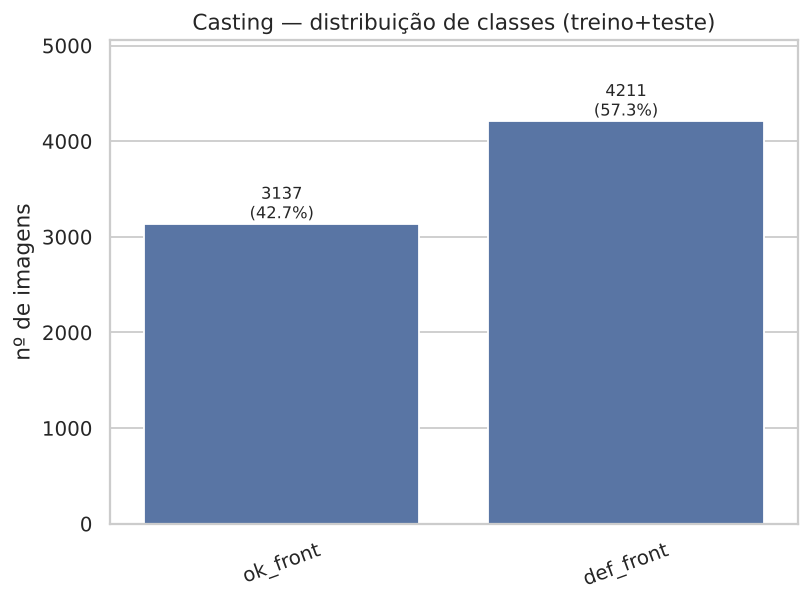

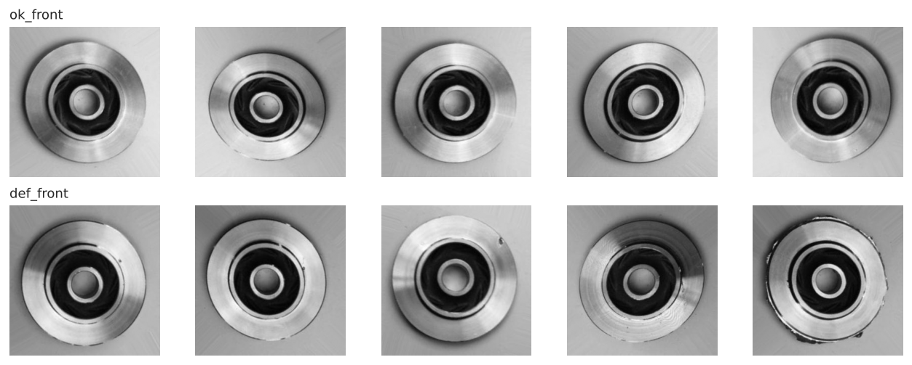

As peças estão sempre centralizadas e com iluminação controlada. Os defeitos (porosidade, rebarbas, trincas na borda, falhas de preenchimento) são **pequenos em relação à peça**.

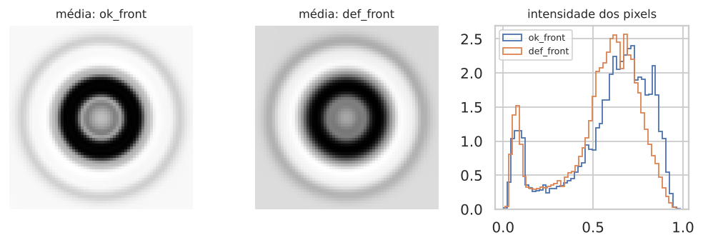

As imagens médias das duas classes são praticamente idênticas, e os histogramas de intensidade se sobrepõem. **Estatísticas globais dos pixels não separam as classes.** É preciso olhar padrões locais, o que motiva usar HOG nos clássicos e convoluções na CNN.

#### Pré-processamento

| Passo | Implementação | Por quê |
|---|---|---|
| Escala de cinza + redimensionamento | `Image.open(p).convert("L").resize((64, 64), Image.BILINEAR)` | 64×64 px é pedido no enunciado. Reduz 22 vezes o nº de pixels e mantém a silhueta e os defeitos maiores. |
| Normalização | `/ 255.0` → pixels em [0, 1] | Escala estável para o gradiente da CNN. |
| Divisão | o teste oficial (715) fica intocado. O treino é dividido em 85% treino + 15% validação, com `train_test_split(..., stratify=y)` | A validação serve à CNN (early stopping e busca). Os clássicos usam todo o treino oficial com CV de 5 folds. |
| Features (clássicos) | HOG com `pixels_per_cell=(8, 8)`, `cells_per_block=(2, 2)` e 9 orientações → 1.764 features, depois PCA(100) | Células 8×8 numa imagem 64×64 dão uma grade 8×8, fina o bastante para localizar defeitos pequenos. |

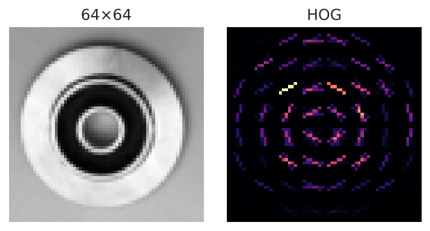

**HOG × pixels achatados** (F1 macro, CV de 3 folds, hiperparâmetros padrão):

| Modelo | Flatten 32×32 + PCA | HOG + PCA |
|---|---|---|
| SVM | 0,975 | **0,985** |
| RF | **0,988** | 0,946 |
| NB | 0,807 | **0,816** |

O HOG foi melhor para SVM e NB, mas o RF preferiu os pixels. Mantive o HOG para todos os clássicos, porque o enunciado pede **os mesmos dados pré-processados** para todos os modelos e o HOG venceu na maioria dos casos. Esse resultado do RF fica registrado como observação.


#### Hiperparametrização: GridSearch × Optuna

| Modelo | GS: F1 (CV) | GS: avaliações / tempo | Optuna: F1 (CV) | Optuna: trials / tempo | Configuração escolhida |
|---|---|---|---|---|---|
| MLP | 0,9804 | 18 / 26 s | **0,9815** | 25 / 57 s | Optuna: 1 camada de 200, α = 0,016, lr = 0,0066 |
| SVM | 0,9905 | 12 / 30 s | **0,9920** | 25 / 89 s | Optuna: C = 553, γ = 0,0016 |
| AD | **0,8456** | 24 / 26 s | 0,8456 | 25 / 43 s | GS: entropia, profundidade 20, folha ≥ 1 |
| RF | 0,9545 | 12 / 166 s | **0,9547** | 25 / 449 s | Optuna: 350 árvores, profundidade 31, max_features 0,15 |
| NB | 0,8219 | 11 / 8 s | 0,8219 | 12 / 12 s | var_smoothing ≈ 6·10⁻⁵ |
| CNN | **0,9990** | 8 / 42 min | 0,9990 | 12 / 57 min (4 podados) | GS: 16 filtros, 3 blocos, Dense 128, dropout 0,5, lr 10⁻³ |

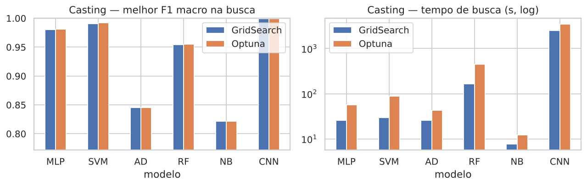

O que as escolhas dizem:

- **SVM:** o Optuna encontrou **C = 553**, muito acima do maior valor da grade (100). Isso indica que as classes são quase separáveis no espaço HOG+PCA, e uma margem "dura" (pouca regularização) funciona. O γ = 0,0016 está perto de 10⁻³, o melhor valor da grade.
- **MLP:** uma única camada de 200 neurônios basta para 100 entradas. O α = 0,016 é uma regularização maior que a da grade e compensa a camada larga.
- **AD:** a árvore precisa ir fundo (profundidade 20) para separar as classes, sinal de fronteira complexa, e mesmo assim fica em F1 ≈ 0,85.
- **RF:** `max_features ≈ 0,15` (15 das 100 componentes em cada divisão) mantém as árvores descorrelacionadas. Mais árvores e profundidade dão ganho marginal (0,9545 → 0,9547).
- **CNN:** GridSearch e Optuna empataram (F1 de validação 0,999). Fica a rede mais simples (16 filtros, 81 mil parâmetros), com dropout de 0,5.

#### Resultados no teste (715 imagens)

| Modelo | Acurácia | Precisão | Recall | F1 macro | Tempo de treino (s) |
|---|---|---|---|---|---|
| **CNN** | **0,9958** | **0,9951** | **0,9959** | **0,9955** | 314,1 |
| SVM | 0,9916 | 0,9895 | 0,9926 | 0,9910 | 2,3 |
| MLP | 0,9818 | 0,9764 | 0,9857 | 0,9806 | 2,0 |
| RF | 0,9734 | 0,9725 | 0,9702 | 0,9713 | 5,5 |
| AD | 0,8615 | 0,8488 | 0,8642 | 0,8544 | 1,8 |
| NB | 0,8448 | 0,8350 | 0,8574 | 0,8394 | 1,0 |

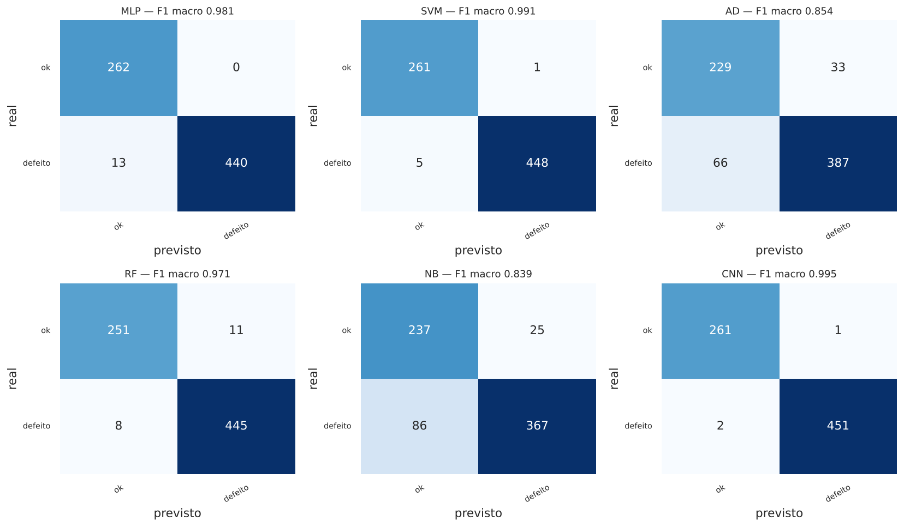

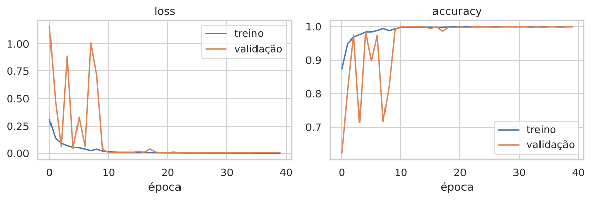

#### Falsos negativos: a peça defeituosa aprovada

Em controle de qualidade, o erro mais caro é aprovar uma peça defeituosa, que segue para o cliente. Rejeitar uma peça boa custa só uma reinspeção.

| Modelo | FN (defeito aprovado) | FP (ok rejeitada) | Recall do defeito | Especificidade |
|---|---|---|---|---|
| **CNN** | **2** | 1 | 0,996 | 0,996 |
| SVM | 5 | 1 | 0,989 | 0,996 |
| RF | 8 | 11 | 0,982 | 0,958 |
| MLP | 13 | 0 | 0,971 | 1,000 |
| AD | 66 | 33 | 0,854 | 0,874 |
| NB | 86 | 25 | 0,810 | 0,905 |

A CNN deixaria passar só **2 das 453** peças defeituosas. O MLP tem o perfil oposto: nenhum falso positivo, mas 13 defeitos aprovados. Na prática, isso pede ajustar o limiar de decisão a favor do defeito. NB e AD não são aceitáveis para essa aplicação.

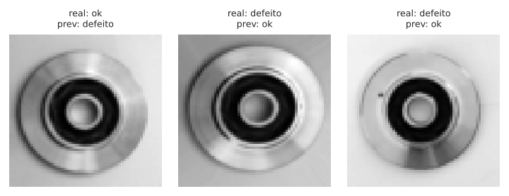

Os erros da CNN aparecem em peças com defeitos muito sutis, perto da borda ou com iluminação diferente, casos que também seriam difíceis para um inspetor humano.

---

### 3.3 Dataset 3: NEU Surface Defect Database

#### Análise exploratória

São 1.800 imagens em tons de cinza, com 200×200 px, divididas em 6 tipos de defeito de chapas de aço laminadas a quente, com **300 imagens por classe** (perfeitamente balanceado). A versão do Kaggle vem dividida em train/valid/test com apenas 72 imagens de teste. Juntei tudo e refiz uma divisão estratificada **70/15/15** (1.260 / 270 / 270), para ter um teste maior e mais confiável.

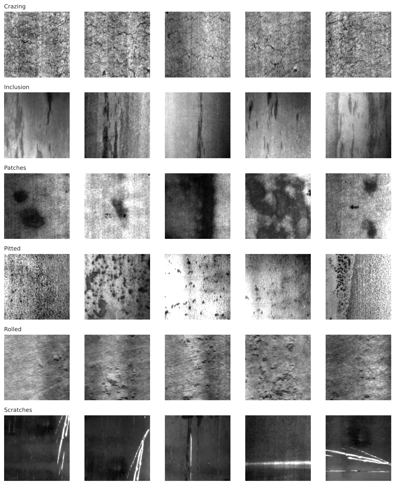

As classes são definidas por **textura**: *crazing* (rede fina de trincas), *inclusion* (manchas escuras alongadas), *patches* (manchas grandes), *pitted surface* (pequenos poços), *rolled-in scale* (carepa pontilhada) e *scratches* (riscos). Há grande variação de brilho e contraste dentro de cada classe.

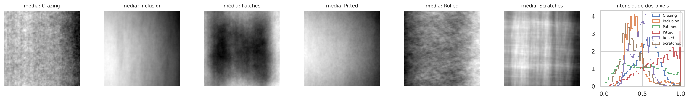

Ao contrário do Casting, o brilho médio varia entre as classes (de 0,37 em *scratches* a 0,69 em *pitted*), mas os histogramas se sobrepõem muito. A informação que separa as classes está na textura.

#### Pré-processamento: o que muda em relação ao Casting

| Decisão | Valor | Justificativa |
|---|---|---|
| Resolução | **128×128 px** | Reduzir de 200 para 64 px apaga a textura fina (as trincas do *crazing*, os poços do *pitted*). O enunciado só impõe 64 px para o Casting. |
| HOG | **células de 16×16 px**, blocos 2×2 → 1.764 features (a mesma dimensão do Casting) | Em textura, células maiores resumem estatísticas de regiões maiores e são mais estáveis. Num teste preliminar com SVM, o F1 foi 0,80 com 64 px e células de 8, 0,87 com 64 px e células de 16, e **0,92 com 128 px e células de 16**. |
| Aumento de dados (só CNN) | `RandomFlip("horizontal_and_vertical")` + `RandomRotation(0.1)` | Defeitos de superfície não têm orientação preferencial, então girar e espelhar não muda o rótulo. É essencial com só 1.260 imagens de treino. |

**HOG × pixels achatados** (CV de 3 folds):

| Modelo | Flatten 32×32 + PCA | HOG + PCA |
|---|---|---|
| SVM | 0,699 | **0,869** |
| RF | 0,807 | **0,871** |
| NB | 0,631 | **0,781** |

Aqui o HOG é claramente superior em todos os modelos, como esperado para textura.

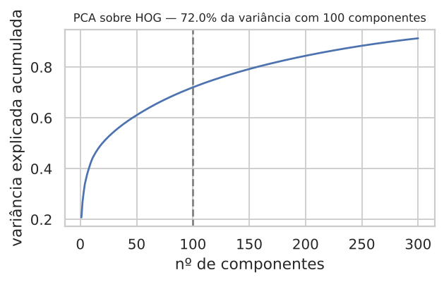

#### Hiperparametrização

| Modelo | GS: F1 (CV) | Optuna: F1 (CV) | Configuração escolhida |
|---|---|---|---|
| MLP | 0,8583 | **0,8724** | Optuna: (128, 64), α = 1,2·10⁻⁵, lr = 0,0087 |
| SVM | 0,8973 | **0,9017** | Optuna: C = 4,5, γ = 0,0019 |
| AD | 0,7946 | **0,7959** | Optuna: gini, profundidade 18, folha ≥ 12 |
| RF | 0,8730 | **0,8791** | Optuna: 300 árvores, profundidade 26, max_features 0,14 |
| NB | **0,7879** | 0,7879 | var_smoothing = 10⁻¹² |
| CNN | **1,0000** | 0,9926 | GS: 32 filtros, 3 blocos, Dense 128, dropout 0,3, lr 10⁻³ |

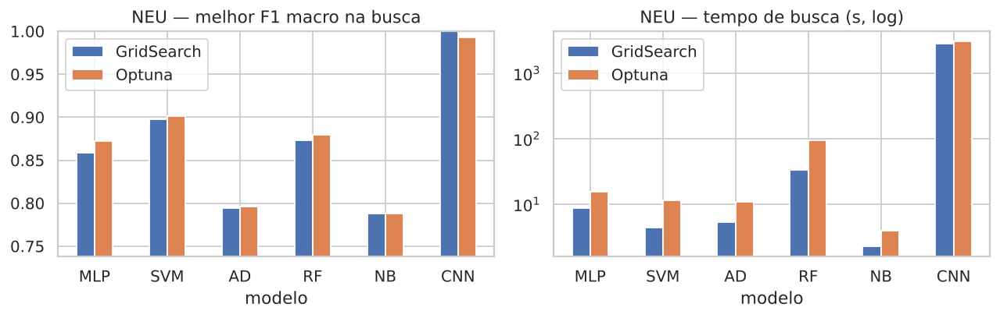

- **SVM:** C = 4,5 (contra 553 no Casting). As classes de textura se sobrepõem mais, e uma margem mais "macia" (mais regularização) generaliza melhor.
- **MLP:** aqui ficaram duas camadas (128, 64), contra uma camada de 200 no Casting. Com 6 classes, a rede precisa de uma representação intermediária.
- **AD:** `min_samples_leaf = 12` regulariza a árvore. Com poucas amostras por classe, folhas muito pequenas decoram ruído.
- **CNN:** precisou de mais filtros que no Casting (32 contra 16; 305 mil parâmetros). Texturas exigem mais detectores diferentes do que a silhueta de uma peça.

#### Resultados no teste (270 imagens)

| Modelo | Acurácia | Precisão | Recall | F1 macro | Tempo de treino (s) |
|---|---|---|---|---|---|
| **CNN** | **0,9926** | **0,9928** | **0,9926** | **0,9926** | 708,8 |
| SVM | 0,9222 | 0,9245 | 0,9222 | 0,9210 | 0,8 |
| MLP | 0,8852 | 0,8908 | 0,8852 | 0,8859 | 0,7 |
| RF | 0,8852 | 0,8851 | 0,8852 | 0,8838 | 1,6 |
| NB | 0,8185 | 0,8362 | 0,8185 | 0,8156 | 0,7 |
| AD | 0,7815 | 0,7862 | 0,7815 | 0,7815 | 1,2 |

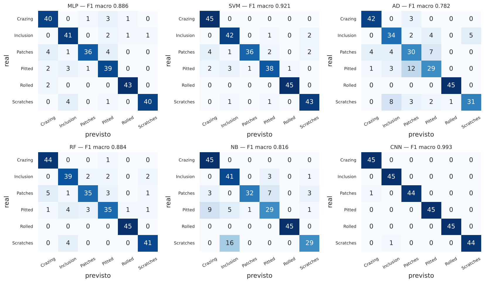

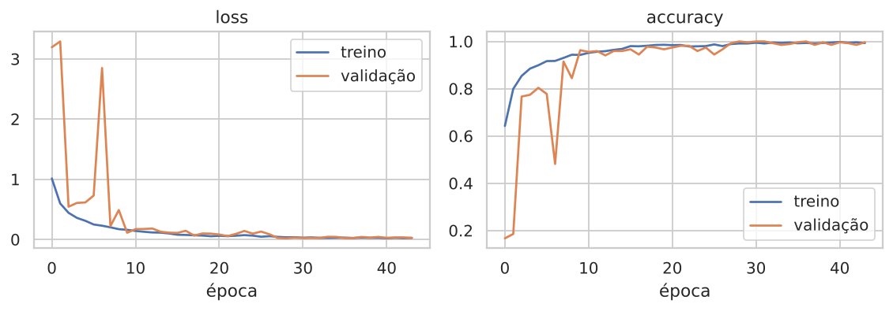

As curvas mostram a instabilidade inicial da validação (épocas 0 a 8), típica da BatchNormalization com poucos dados e aumento de dados. Depois disso, treino e validação convergem juntos, sem sinal de *overfitting*.

#### F1 por classe

| | Crazing | Inclusion | Patches | Pitted | Rolled | Scratches |
|---|---|---|---|---|---|---|
| MLP | 0,86 | 0,87 | 0,87 | 0,83 | 0,96 | 0,93 |
| SVM | 0,94 | 0,91 | 0,88 | 0,87 | 0,99 | 0,94 |
| AD | 0,91 | 0,72 | 0,63 | 0,67 | 0,99 | 0,77 |
| RF | 0,93 | 0,84 | 0,82 | 0,81 | 0,99 | 0,91 |
| NB | 0,88 | 0,77 | 0,82 | 0,69 | 1,00 | 0,73 |
| **CNN** | **0,99** | **0,99** | **0,99** | **1,00** | **1,00** | **0,99** |

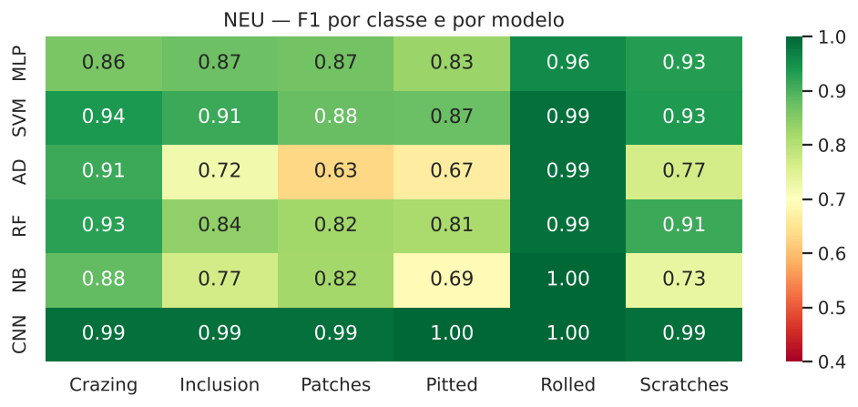

- ***Rolled-in scale*** é fácil para todos (F1 ≥ 0,96): tem uma textura pontilhada muito característica.
- ***Pitted*** e ***patches*** são as classes mais difíceis para os clássicos. Na AD, 12 imagens *pitted* foram classificadas como *patches*. As duas classes têm manchas de tamanho e contraste variados, e o histograma de gradientes do HOG fica parecido.
- ***Scratches* × *inclusion***: o NB confundiu 16 riscos com inclusões. As duas classes são estruturas alongadas e escuras, e a diferença está na forma (linha contínua contra mancha), que o NB, com sua hipótese de independência, não captura.
- A **CNN erra só 2 imagens** (1 *patches* → *crazing* e 1 *scratches* → *inclusion*), exatamente nos pares de classes mais parecidos.

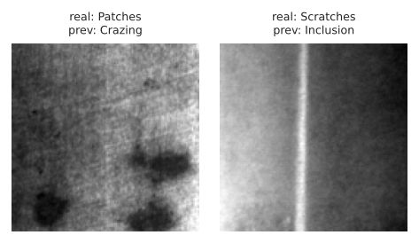

---

### 3.4 Comparação cruzada

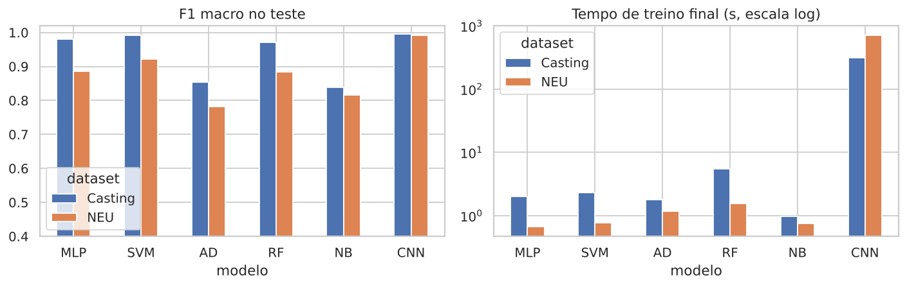

| F1 macro (teste) | MLP | SVM | AD | RF | NB | **CNN** |
|---|---|---|---|---|---|---|
| Casting | 0,981 | 0,991 | 0,854 | 0,971 | 0,839 | **0,996** |
| NEU | 0,886 | 0,921 | 0,782 | 0,884 | 0,816 | **0,993** |

1. **A CNN foi a melhor nos dois datasets**, mas por margens muito diferentes: +0,5 ponto de F1 sobre o SVM no Casting e **+7 pontos** no NEU. No Casting, o HOG já descreve bem as bordas irregulares dos defeitos. No NEU, as classes diferem por texturas sutis que um descritor fixo não separa bem, e é aí que filtros aprendidos fazem diferença.
2. **A ordem entre os clássicos foi a mesma nos dois datasets:** SVM > MLP ≈ RF > NB ≈ AD. O SVM com *kernel* RBF é o mais forte em features contínuas, padronizadas e de dimensão moderada. A árvore única tem alta variância, e o NB viola suas próprias hipóteses (independência e gaussianidade).
3. **Todos os modelos pioram do Casting para o NEU.** Os clássicos perdem de 2 (NB) a 10 (MLP) pontos de F1. O NEU tem 6 classes, 4 vezes menos imagens e textura no lugar de forma. A CNN quase não sente a mudança (−0,3 ponto).
4. **Custo:** a CNN leva de 5 a 12 minutos para treinar em CPU, contra 1 a 6 segundos dos clássicos, cerca de 100 a 1.000 vezes mais. Numa linha de inspeção real, o treino é feito uma vez e a inferência é rápida, então o custo compensa pelo ganho de qualidade, sobretudo no NEU.
5. **GridSearch × Optuna:** nos clássicos, o Optuna igualou (3 casos) ou superou (7 casos) o GridSearch, com ganho máximo de 1,4 ponto (MLP no NEU), porque explora valores contínuos fora da grade. Em compensação, gastou de 1,5 a 3 vezes mais tempo, com 25 trials contra 11 a 24 combinações. Na CNN, as duas buscas chegaram a F1 de validação ≥ 0,99. O Hyperband podou 4 (Casting) e 8 (NEU) dos 12 trials, o que permitiu explorar um espaço maior (2 a 4 blocos, 16 a 48 filtros) a um custo semelhante ao da grade. **Grades bem escolhidas e pequenas competem bem. O Optuna se destaca quando o espaço é grande ou contínuo.**

### 3.5 Lição prática: BatchNormalization e early stopping

Na primeira execução, a CNN do NEU teve F1 de apenas 0,13. A causa: com 1.260 imagens e lotes de 64, há só 20 atualizações por época. As médias móveis da `BatchNormalization` (momentum padrão de 0,99) levam centenas de passos para convergir, e por isso a rede funciona bem em modo treino mas mal em modo inferência nas primeiras épocas. A `val_loss` fica errática, e o `EarlyStopping` restaurava os pesos de uma das primeiras épocas. A correção teve duas partes: `BatchNormalization(momentum=0.9)`, para que as médias convirjam em poucas épocas, e `EarlyStopping(start_from_epoch=5)`, para ignorar o transiente inicial. Com isso, o F1 passou de 0,13 para 0,99.
## 4. Parte 2: prognóstico de RUL com RNN (C-MAPSS FD001)

### 4.1 O problema

A manutenção preditiva busca intervir **no momento certo**: nem cedo demais (desperdício de peças e mão de obra), nem tarde demais (falha em operação). O indicador central é a **Vida Útil Remanescente (RUL)**, isto é, quantos ciclos o equipamento ainda opera antes de falhar.

O C-MAPSS é um simulador da NASA de um motor turbofan. O sub-conjunto FD001 traz 100 motores de treino, cada um observado do ciclo 1 até a falha, e 100 motores de teste, cujas séries são interrompidas antes da falha. Para os motores de teste, o arquivo `RUL_FD001.txt` informa o RUL verdadeiro. Há uma única condição de operação (cruzeiro) e um único modo de falha (degradação do compressor de alta pressão, HPC). Cada linha é um ciclo, com 3 condições operacionais e 21 sensores.

### 4.2 Análise exploratória

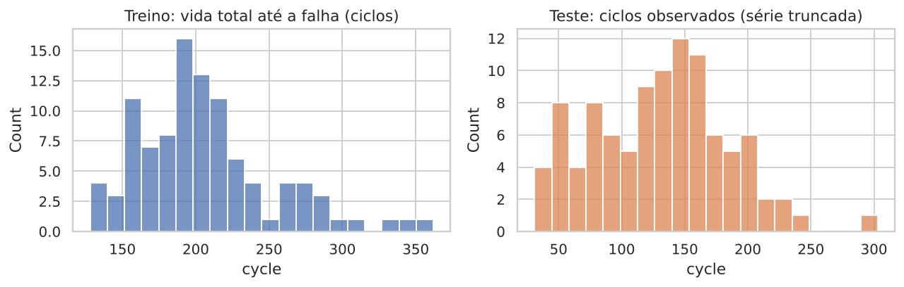

No treino, a vida até a falha vai de 128 a 362 ciclos (média 206). No teste, as séries observadas têm de 31 a 303 ciclos, e o RUL verdadeiro vai de 7 a 145. **O motor de teste mais curto tem só 31 ciclos.** Isso vai limitar o tamanho da janela.

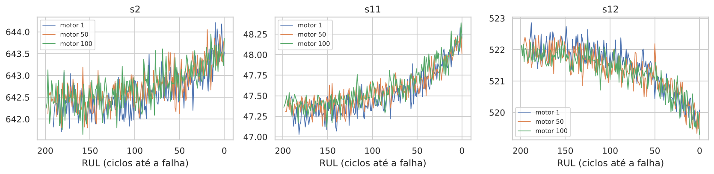

Os sensores ficam estáveis durante boa parte da vida (só ruído) e começam a mudar de forma acelerada perto da falha: T24 (s2) e Ps30 (s11) sobem, e phi (s12) cai. Isso tem uma consequência prática: **no início da vida, os sensores não conseguem distinguir RUL = 300 de RUL = 200**.

**Sensores constantes.** Calculei o desvio padrão e o nº de valores distintos de cada sensor. Os sensores s1, s5, s10, s16, s18 e s19 têm um único valor em todo o treino, e o s6 tem só 2 valores (desvio ≈ 0,001). Esses 7 sensores não carregam informação sobre a degradação e foram removidos. As 3 condições operacionais também foram descartadas: no FD001 elas são constantes a menos de ruído. Sobram os **14 sensores** da tabela do enunciado.

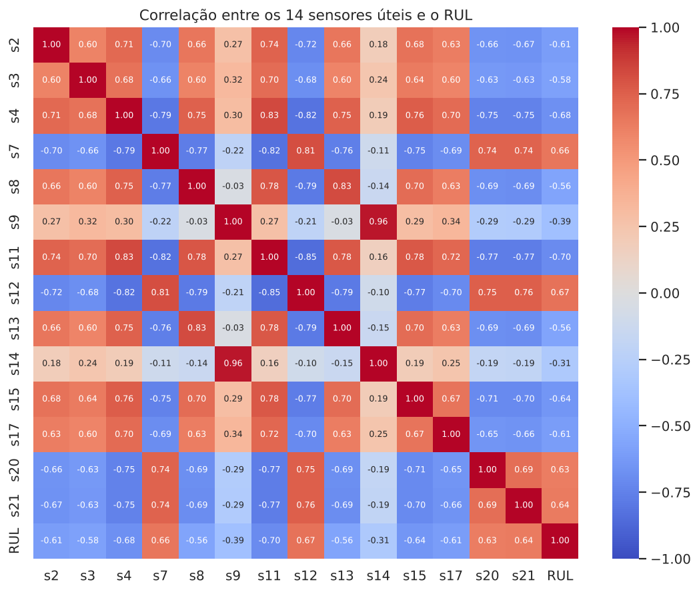

A matriz de correlação mostra dois blocos: sensores que **crescem** com a degradação (s2, s3, s4, s8, s11, s13, s15, s17) e sensores que **decrescem** (s7, s12, s20, s21). Os sensores s9 e s14 (velocidades do *core*) têm correlação de 0,96 entre si. A redundância é alta, mas a RNN combina essas medidas ruidosas, o que funciona como uma média que reduz o ruído.

### 4.3 Pré-processamento (e por que cada passo)

| Passo | Implementação | Justificativa |
|---|---|---|
| Divisão treino/validação **por motor** | 80 motores de treino e 20 de validação, sorteados com `np.random.default_rng(42)` | Janelas vizinhas do mesmo motor são quase idênticas. Dividir por amostra colocaria "a mesma informação" nos dois lados e daria uma validação otimista. |
| Remoção de sensores e de `unit_id` | ficam 14 colunas de sensores | `unit_id` é só um identificador: não tem significado físico. Ele é usado apenas para agrupar as janelas por motor. |
| Normalização | `MinMaxScaler().fit(treino)` e depois `.transform(...)` em treino, validação e teste | O scaler aprende mínimo e máximo **só com os motores de treino**. Ajustar no teste usaria informação que não existe no momento da previsão (vazamento). Além disso, o teste é truncado, com motores mais "saudáveis", e um scaler próprio colocaria o mesmo valor físico em posições diferentes da escala. |
| RUL de cada linha | `RUL = ciclo_máximo_do_motor − ciclo` | É a definição de RUL(t) = T_falha − t. |
| Alvo *piece-wise linear* | `RUL.clip(upper=130)` | Como vimos na EDA, no início da vida os sensores não distinguem RULs altos. Sem o clipping, a rede seria punida por não adivinhar o que não está nos dados. |
| Janelas deslizantes | `make_windows(df, W, motores)`: stride 1, forma (W, 14), alvo = RUL clipado do último ciclo da janela | Transforma cada série em várias amostras supervisionadas. |
| Janela de teste | só a **última** janela de cada motor. Motores com menos de W ciclos recebem *padding* repetindo a primeira leitura | O RUL verdadeiro do teste se refere ao último ciclo observado. |

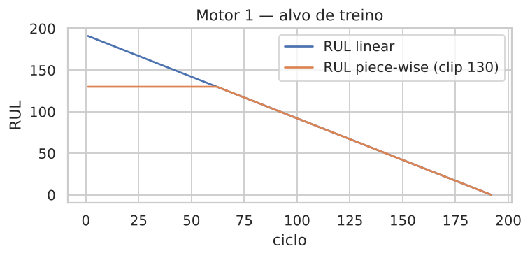

**O efeito de W.** Janelas maiores dão mais contexto da tendência e filtram o ruído, mas reduzem o nº de amostras: cada motor perde W − 1 janelas, e o total cai de 18.731 (W = 20) para 15.731 (W = 50). Elas também aumentam o custo e exigem *padding* nos motores de teste curtos (0 motores com W = 30, 4 com W = 40 e 7 com W = 50). Por isso W entrou no espaço de busca do Optuna.

### 4.4 Arquitetura de partida e treinamento

O modelo de partida, antes de qualquer busca, é uma **LSTM com 2 camadas de 64 neurônios, W = 30, dropout 0,2, Dense(32, ReLU) e saída Dense(1, linear)**, treinada com Adam (lr = 10⁻³), perda MSE e `batch_size=256`. A construção, os callbacks e o papel de `return_sequences` estão explicados na seção 2.8. As escolhas:

- **LSTM**: os portões preservam a tendência lenta de degradação ao longo dos 30 passos da janela.
- **2 camadas × 64**: a primeira extrai padrões locais da sequência e a segunda os resume. Para 14 entradas e cerca de 14 mil janelas, 64 neurônios dão capacidade suficiente (55 mil parâmetros) sem *overfitting* excessivo.
- **W = 30**: é o maior valor que não exige *padding* no teste (o motor mais curto tem 31 ciclos).
- **lr = 10⁻³**: é o padrão do Adam e é estável para RNNs. O `ReduceLROnPlateau` reduz o lr quando o treino estagna.

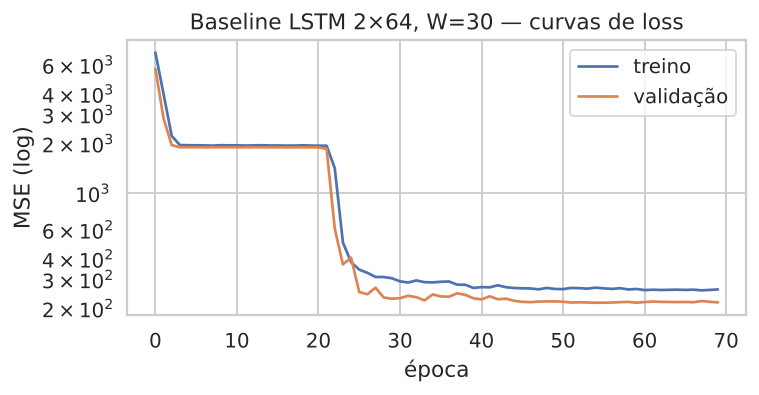

**Comparação de células** (mesma arquitetura, W = 30):

| Célula | Parâmetros | Épocas até parar | Tempo (s) | Melhor val RMSE |
|---|---|---|---|---|
| SimpleRNN | 15.425 | 88 | 90 | 14,50 |
| LSTM | 55.361 | 70 | 219 | 14,69 |
| GRU | 42.433 | 34 | 114 | **14,21** |

Com janelas de 30 passos as três células ficam próximas. Mesmo assim, a GRU foi a melhor, convergiu na metade das épocas e tem menos parâmetros que a LSTM.

### 4.5 Optuna: TPE + Hyperband

O espaço de busca:

| Hiperparâmetro | Espaço | Por quê |
|---|---|---|
| `W` | {20, 30, 40, 50} | Compromisso entre contexto e nº de amostras/*padding*. |
| `cell` | {SimpleRNN, LSTM, GRU} | Pedido no enunciado. Compara memória com e sem portões. |
| `n_layers` | 1 a 3 | Profundidade da extração temporal. |
| `units` | {32, 64, 96, 128} | Capacidade. |
| `dropout` | 0,0 a 0,5 | Regularização. |
| `lr` | 10⁻⁴ a 10⁻² (log) | O passo do Adam tem efeito multiplicativo, por isso a escala log. |

São 30 trials com no máximo 40 épocas cada. O `HyperbandPruner(min_resource=5, max_resource=40)` recebe o val RMSE a cada época, por um callback Keras próprio que chama `trial.report` e `trial.should_prune`. O objetivo é **minimizar o val RMSE** nos motores de validação.

Resultado: 13 trials completos e 17 podados, em 62 minutos. O melhor foi **GRU, 2 camadas × 96, W = 50, dropout 0,30 e lr 1,45·10⁻³**, com val RMSE = 12,15.

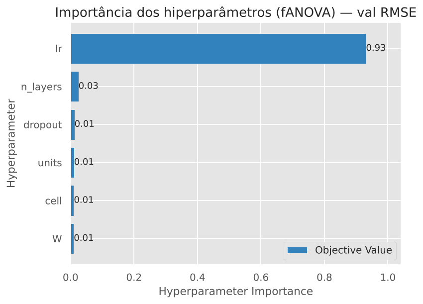

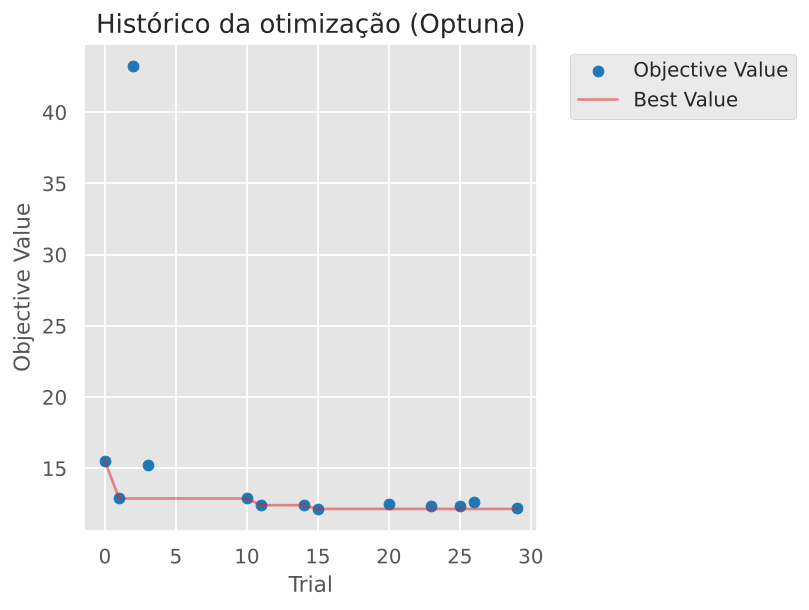

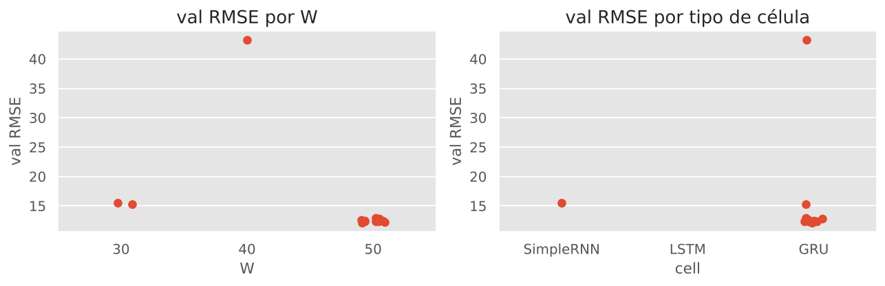

- **O learning rate domina (93% da importância, pela fANOVA).** O treino de regressão passa por um **platô inicial**: nas primeiras épocas a rede prevê a média do RUL, com val RMSE ≈ 43. Só depois ela "descobre" a tendência dos sensores e o erro despenca (ver a curva de loss do modelo final). Com um lr inadequado, a rede fica presa no platô. É por isso que vários trials aparecem com valor ≈ 43, a maioria podados. Uma limitação do Hyperband aqui é que trials que demoram a sair do platô podem ser podados cedo.
- **W = 50 venceu claramente.** Os 10 melhores trials usam W = 50 (val RMSE de 12,2 a 12,9), contra cerca de 15,3 com W = 30. O contexto extra compensou a perda de amostras e o *padding* de 7 motores.
- **GRU dominou.** Depois dos primeiros trials, o TPE concentrou a busca na GRU (12 dos 13 trials completos). Isso é coerente com a comparação de células acima.

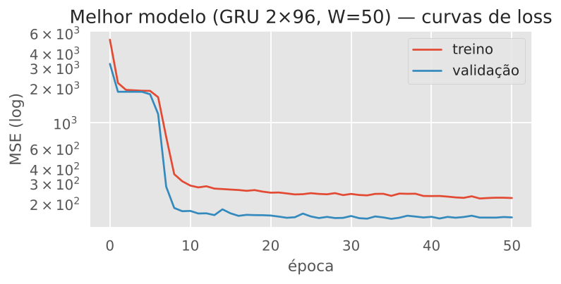

O modelo final foi treinado por até 150 épocas (parou na 51ª) e salvo em `modelos/rnn_rul_fd001_best.keras`, pronto para inferência com `keras.models.load_model`.

### 4.6 Resultados no teste completo (100 motores)

| Modelo | RMSE | MAE | NASA Score |
|---|---|---|---|
| LSTM 2×64, W = 30 (partida) | 15,03 | 11,12 | 411 |
| **GRU 2×96, W = 50 (Optuna)** | **14,54** | **10,83** | **379** |

As métricas são calculadas contra o RUL verdadeiro **sem clipping**, a avaliação mais rigorosa. Com o RUL real clipado em 130, convenção comum em artigos, o RMSE da GRU cai para 13,99. Esses números estão na faixa reportada na literatura para FD001 com redes recorrentes (RMSE ≈ 12–16).

> **Nota sobre o NASA Score.** O enunciado transcreve as constantes invertidas (10 para d < 0 e 13 para d ≥ 0). No artigo original (Saxena et al., 2008, Eq. 11), a₁ = 13 é usado para previsões antecipadas e a₂ = 10 para atrasadas. Assim, a previsão atrasada, que é a perigosa, é a mais punida. Reporto o score do artigo (379). Com as constantes do enunciado, o resultado seria 356.

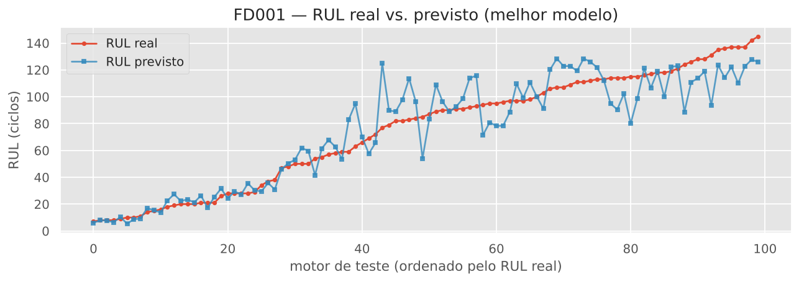

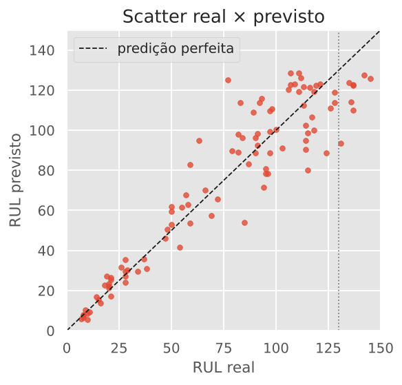

### 4.7 Quando o modelo erra mais?

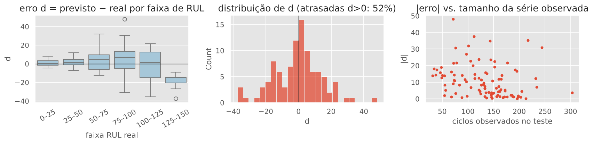

| Faixa de RUL real | n | Erro médio (d) | RMSE |
|---|---|---|---|
| 0–25 | 19 | +0,9 | 3,4 |
| 25–50 | 14 | +1,7 | 5,5 |
| 50–75 | 10 | +4,6 | 14,6 |
| 75–100 | 24 | +4,9 | 18,2 |
| 100–125 | 22 | −2,6 | 16,7 |
| 125–150 | 11 | −18,1 | 19,6 |

1. **Perto da falha, o modelo é muito preciso.** Com RUL < 50, o RMSE fica entre 3 e 6 ciclos. É exatamente a região em que a decisão de manutenção é tomada.
2. **O erro cresce com o RUL.** Com o motor ainda saudável, os sensores são basicamente ruído e não há informação para estimar a vida restante.
3. **Acima de 125 ciclos, o modelo sempre subestima** (erro médio −18). É o efeito esperado do clipping em 130. Esse erro é conservador e barato no NASA Score.
4. **Séries curtas são as mais difíceis.** O maior erro (motor 67: real 77, previsto 125) vem de um motor com apenas 71 ciclos observados: a janela ainda está na fase "saudável".
5. Os erros são aproximadamente simétricos (52% das previsões atrasadas). Em uso real, seria possível deslocar as previsões alguns ciclos para baixo, trocando um pouco de RMSE por mais segurança.
## 5. Conclusões

- **CNN × clássicos.** A CNN foi a melhor nos dois datasets de imagem. A vantagem é pequena quando um descritor manual (HOG) já captura o que diferencia as classes (Casting: 0,996 contra 0,991 do SVM) e grande quando a diferença está em texturas sutis (NEU: 0,993 contra 0,921). Entre os clássicos, o SVM com *kernel* RBF foi consistentemente o melhor, e a Árvore de Decisão e o Naive Bayes os piores.
- **Do ponto de vista do chão de fábrica**, a métrica que importa no Casting é o falso negativo. A CNN aprovaria 2 peças defeituosas em 453, o SVM 5, e o NB 86.
- **RNN para RUL.** A GRU com janela de 50 ciclos estimou a vida remanescente com RMSE de 14,5 ciclos. O erro é pequeno (3 a 6 ciclos) justamente perto da falha, onde a decisão de manutenção é tomada, e cresce quando o motor ainda está saudável e os sensores não têm informação. Isso confirma a utilidade do alvo *piece-wise linear*.
- **GridSearch × Optuna.** Com orçamentos parecidos, o Optuna igualou ou superou a grade em todos os casos, com ganhos pequenos (até 1,4 ponto de F1) e custo maior. Ele vale mais em espaços grandes e contínuos, como o da RNN (6 hiperparâmetros, incluindo o tamanho da janela), onde a poda do Hyperband interrompeu 17 dos 30 trials.
- **Limitações.** As buscas usaram poucos trials, pelo custo em CPU. O dataset Casting contém imagens aumentadas das mesmas peças, então pode haver peças "parentes" em treino e teste. No FD001, a validação usou apenas 20 motores.

## Referências

- Saxena, A., Goebel, K., Simon, D. & Eklund, N. (2008). *Damage Propagation Modeling for Aircraft Engine Run-to-Failure Simulation*. PHM'08.
- Heimes, F. O. (2008). *Recurrent Neural Networks for Remaining Useful Life Estimation*. PHM'08.
- Song, K. & Yan, Y. (2013). *A noise robust method based on completed local binary patterns for hot-rolled steel strip surface defects*. Applied Surface Science.
- Dabhi, R. (2020). *Casting product image data for quality inspection*. Kaggle.
- Dalal, N. & Triggs, B. (2005). *Histograms of Oriented Gradients for Human Detection*. CVPR.
- Hochreiter, S. & Schmidhuber, J. (1997). *Long Short-Term Memory*. Neural Computation.
- Cho, K. et al. (2014). *Learning Phrase Representations using RNN Encoder–Decoder for Statistical Machine Translation* (GRU). EMNLP.
- Ioffe, S. & Szegedy, C. (2015). *Batch Normalization*. ICML.
- Akiba, T. et al. (2019). *Optuna: A Next-generation Hyperparameter Optimization Framework*. KDD.
- Li, L. et al. (2018). *Hyperband: A Novel Bandit-Based Approach to Hyperparameter Optimization*. JMLR.
